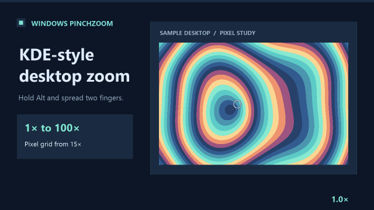

# Windows PinchZoom

A Windows desktop magnifier with KDE-style **Alt + two-finger pinch** on supported touchpads. Zoom into the desktop around your pointer, up to 100×, with a pixel grid at 15× and above. Mouse wheel and keyboard controls are also available.

[Download v0.1.0 for Windows 11 x64](https://github.com/KHammer404/windows-pinchzoom/releases/download/v0.1.0/Windows-PinchZoom-v0.1.0-win-x64.zip) · [Pre-release notes](https://github.com/KHammer404/windows-pinchzoom/releases/tag/v0.1.0) · [Report input compatibility](https://github.com/KHammer404/windows-pinchzoom/issues/new?template=compatibility.yml)

*Recorded CF-SV1 pinch input replayed on an illustrated desktop using the app's capture renderer.*

## Download and use

Extract the ZIP and run **Windows-PinchZoom.exe**. The portable build runs in the background without installing a driver. Run the executable each time you want to use it.

| Input | What to do |
| --- | --- |
| Tested CF-SV1 Synaptics touchpad | Hold **Alt** and spread or pinch two fingers. Disable **Pinch Zoom** in Synaptics settings if the browser zooms independently. |
| Windows Precision Touchpad | Try **Alt** + two-finger pinch. This is experimental and needs testing on more hardware. |
| Mouse wheel | Hold **Alt** and scroll. Some touchpads also emit compatible scroll events. |
| Keyboard | **Ctrl+Alt+Plus/Minus** magnifies or reduces the desktop in standard mode. **Ctrl+Alt+0** resets to 100% in standard mode. |
| Exit | **Ctrl+Shift+F12** returns the desktop to 100% and closes the app. |

On the supported Synaptics device, the app selects the device-specific input path automatically. Run **Windows-PinchZoom.exe --standard** to test the standard input path on the same device, or use **--wheel** to skip Precision Touchpad input. Exit the current copy before changing modes.

## Compatibility

| Setup | What has been verified |
| --- | --- |
| Panasonic Let's note CF-SV1RDLVS · Synaptics `SYNA0102`, driver `19.5.26.24` · Windows 11 x64 · one active display | Two-finger pinch tested on one laptop. |
| Standard mode · Windows 11 x64 · one active display | Mouse wheel and keyboard zoom handlers verified with simulated input on the test laptop. |
| Windows Precision Touchpad | Experimental. Pinch depends on which contact reports the device exposes. Try the mouse wheel or keyboard if pinch fails. |
| Other legacy touchpads, including other `SYNA0102` models | Untested. The detected device ID alone does not confirm the report format. |
| Multiple displays | Experimental in standard mode. The app targets the display under the pointer. |

Use the [compatibility form](https://github.com/KHammer404/windows-pinchzoom/issues/new?template=compatibility.yml) to tell us which laptop, Windows version and input method you tried. Working setups are welcome too.

Quit Windows Magnifier or another desktop magnifier before starting. On a single display the app uses native Windows magnification at low zoom. The capture renderer draws the high-zoom view and pixel grid in one click-through window. Captured frames stay in memory, and protected video may appear blank.

## Build from source

Run **build.cmd** on Windows x64. It uses the compiler from the installed .NET Framework and writes the portable executable to **dist**. Run **build.cmd console** for a build with console diagnostics.
